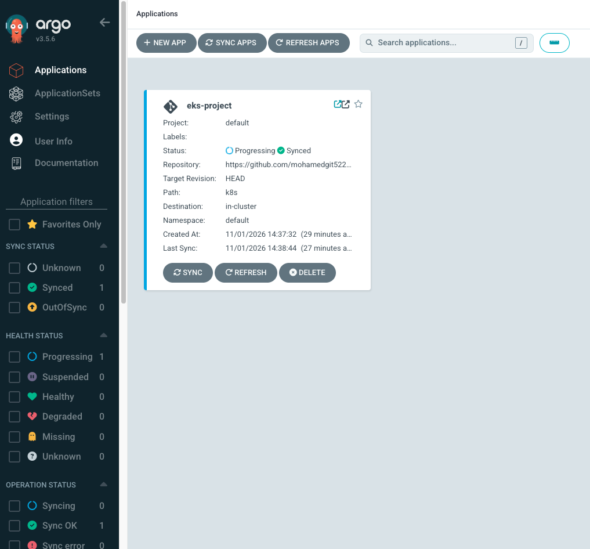
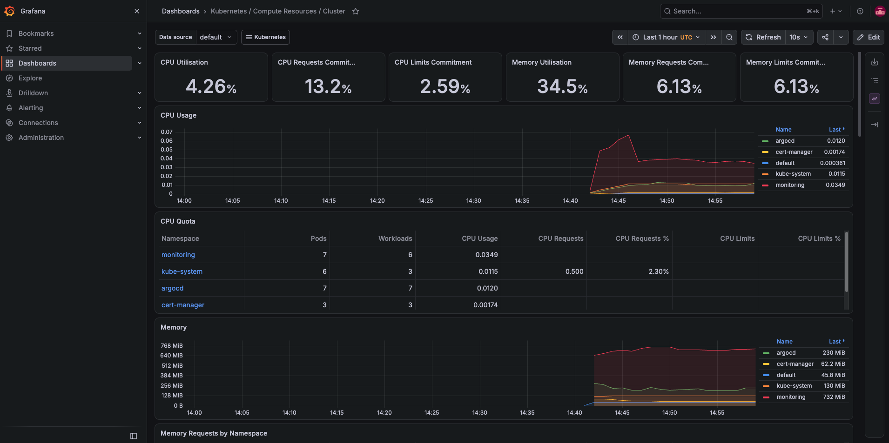
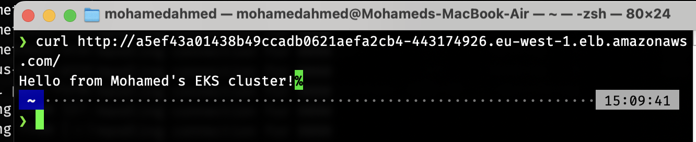

# EKS Production-Grade Deployment

A production-style Kubernetes project built on AWS EKS. Covers infrastructure provisioning, containerised app deployment, GitOps-based continuous delivery, TLS certificate management, and cluster observability — all wired together and automated.

---

## What This Project Does

A Flask app runs as a containerised workload on an EKS cluster. Every push to `main` triggers a GitHub Actions pipeline that builds a new Docker image, tags it with the commit SHA, and pushes it to ECR. The pipeline then updates the Kubernetes deployment manifest with the new image tag and commits the change back to the repo. ArgoCD — running inside the cluster — detects the change and rolls out the new version automatically, with no manual `kubectl apply` and no cluster credentials stored in the pipeline.

The entire infrastructure is defined in Terraform. Tear it down, run `terraform apply`, and the cluster is back in under 15 minutes. Prometheus scrapes metrics from every namespace in the cluster, and Grafana puts them on a live dashboard so you can see exactly what's running and where resources are going.

---

## Architecture

```

Developer pushes to main
│
▼
GitHub Actions CI/CD Pipeline
├── Build Docker image
├── Tag with commit SHA
├── Push to ECR
└── Update k8s/deployment.yaml with new image tag
│
▼
ArgoCD (running in cluster)
├── Detects change in k8s/ folder
├── Compares desired state (Git) vs live state (cluster)
└── Syncs automatically — rolls out new pods
│
▼
EKS Cluster (eu-west-1)
├── 2x worker nodes (managed node group)
├── Flask app — 2 replicas behind a LoadBalancer
├── cert-manager — handles TLS certificates
├── Prometheus — scrapes metrics across all namespaces
└── Grafana — dashboards for CPU, memory, pod health

```

---

## Tech Stack

| Layer | Tool |
|---|---|
| Cloud | AWS (EKS, ECR, VPC, IAM, ALB) |
| Infrastructure as Code | Terraform |
| Containerisation | Docker |
| Orchestration | Kubernetes (EKS v1.31) |
| GitOps | ArgoCD |
| CI/CD | GitHub Actions (OIDC — no static keys) |
| TLS | cert-manager |
| Metrics | Prometheus + Grafana (kube-prometheus-stack) |
| App | Python Flask |

---

## Repository Structure

​```
eks-project/
├── app/
│ ├── app.py
│ ├── requirements.txt
│ └── Dockerfile
├── k8s/
│ ├── deployment.yaml
│ ├── service.yaml
│ ├── ingress.yaml
│ └── clusterissuer.yaml
├── infra/
│ ├── main.tf
│ ├── variables.tf
│ ├── outputs.tf
│ └── modules/
│ ├── vpc/
│ └── eks/
├── screenshots/
│ ├── argocd-synced.png
│ ├── grafana-cluster.png
│ └── app-live.png
├── argocd-app.yaml
└── .github/
└── workflows/
└── deploy.yml
​
```
---

## CI/CD Pipeline

The pipeline uses OIDC authentication — no AWS access keys stored in GitHub. GitHub exchanges a signed token with AWS at runtime to assume an IAM role scoped to exactly what the pipeline needs: push to ECR, nothing else.

On every push to `main`:

1. Authenticate to AWS via OIDC
2. Build Docker image, tag with the commit SHA
3. Push to ECR
4. Update `k8s/deployment.yaml` with the new image tag
5. Commit the change back to the repo
6. ArgoCD detects the manifest change and rolls out the new version

The image tag is always the commit SHA — so every deployment is traceable back to an exact commit.

---

## GitOps with ArgoCD

ArgoCD runs inside the cluster and watches the `k8s/` folder in this repo. It polls every 3 minutes and syncs automatically when it detects drift between what's in Git and what's running in the cluster.

Why this matters over direct `kubectl apply`:
- Every change to the cluster is a Git commit — full audit trail
- Roll back any deployment by reverting a commit
- The pipeline never needs cluster credentials
- If someone manually changes something in the cluster, ArgoCD reverts it (`selfHeal: true`)

---

## Infrastructure

Everything is provisioned with Terraform using a remote S3 backend with DynamoDB state locking.

What Terraform manages:
- VPC with public and private subnets across 2 availability zones
- Internet Gateway, NAT Gateway, route tables
- EKS cluster (control plane + managed node group)
- IAM roles for the cluster, node group, and GitHub Actions pipeline
- OIDC provider for keyless CI/CD

Rebuild the cluster from scratch:

```bash
export AWS_PROFILE=mohamed
cd infra/
terraform init
terraform apply
aws eks update-kubeconfig --region eu-west-1 --name eks-project
```

---

## Observability

Prometheus and Grafana are deployed via the `kube-prometheus-stack` Helm chart into the `monitoring` namespace.

Prometheus scrapes metrics from:
- All application pods
- Kubernetes system components (kube-state-metrics)
- Both worker nodes (node-exporter)

Grafana comes pre-loaded with Kubernetes dashboards. The **Kubernetes / Compute Resources / Cluster** dashboard shows real-time CPU and memory usage broken down by namespace.

Access Grafana:

```bash
kubectl port-forward svc/kube-prometheus-stack-grafana 3000:80 -n monitoring
# Open http://localhost:3000
# Username: admin
# Password: kubectl get secret kube-prometheus-stack-grafana -n monitoring \
#   -o jsonpath="{.data.admin-password}" | base64 --decode
```

---

## How to Deploy

Prerequisites: AWS CLI, kubectl, Terraform, Helm, Docker

**1. Provision infrastructure**
```bash
cd infra/
terraform init
terraform apply
aws eks update-kubeconfig --region eu-west-1 --name eks-project
```

**2. Install ArgoCD**
```bash
kubectl create namespace argocd
kubectl apply -n argocd -f https://raw.githubusercontent.com/argoproj/argo-cd/stable/manifests/install.yaml
```

**3. Install cert-manager**
```bash
kubectl apply -f https://github.com/cert-manager/cert-manager/releases/download/v1.13.0/cert-manager.yaml
```

**4. Apply the ArgoCD Application manifest**
```bash
kubectl apply -f argocd-app.yaml
```

**5. Install Prometheus + Grafana**
```bash
helm repo add prometheus-community https://prometheus-community.github.io/helm-charts
helm repo update
helm install kube-prometheus-stack prometheus-community/kube-prometheus-stack \
  --namespace monitoring --create-namespace
```

**6. Verify**
```bash
kubectl get pods -n default
kubectl get pods -n argocd
kubectl get pods -n monitoring
curl http://<LoadBalancer-URL>/
```

---

## Screenshots

### ArgoCD — Synced


### Grafana — Cluster Dashboard


### App Live


---

## Key Design Decisions

**OIDC over static keys** — the pipeline authenticates to AWS using a temporary token scoped to a single IAM role. No secrets stored in GitHub, no rotation needed, no blast radius if the repo is compromised.

**Separate IAM roles** — the pipeline role can push to ECR and trigger deployments. The app's instance role can only read the one secret it needs. If either is compromised, the damage stays contained.

**GitOps over direct apply** — ArgoCD means the cluster state is always a reflection of what's in Git. No one-off `kubectl apply` commands that leave the cluster in an undocumented state.

**Terraform remote state** — S3 backend with DynamoDB locking means infrastructure state is shared and consistent. No two engineers can run `apply` at the same time.

---

## Author

Mohamed Ahmed — [GitHub](https://github.com/mohamedgit522) · [LinkedIn](https://www.linkedin.com/in/mohamed-ahmed-1a428320a/)

DevOps Engineer · London, UK
